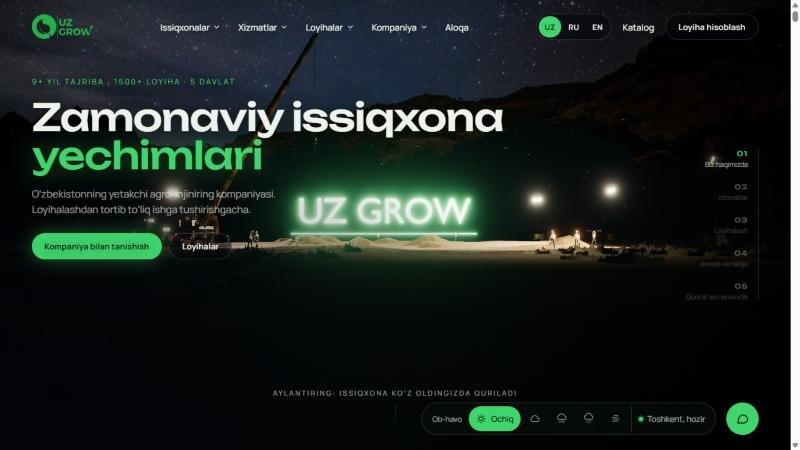
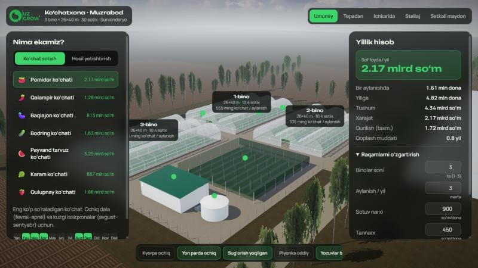
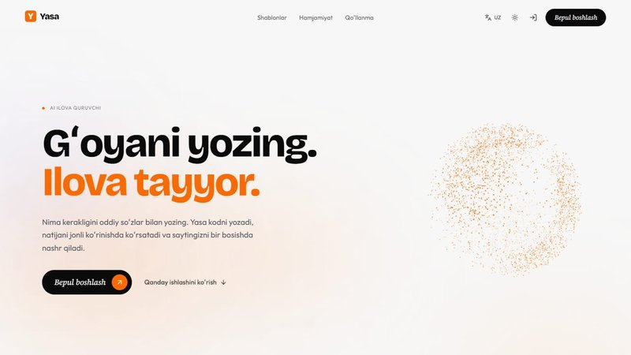
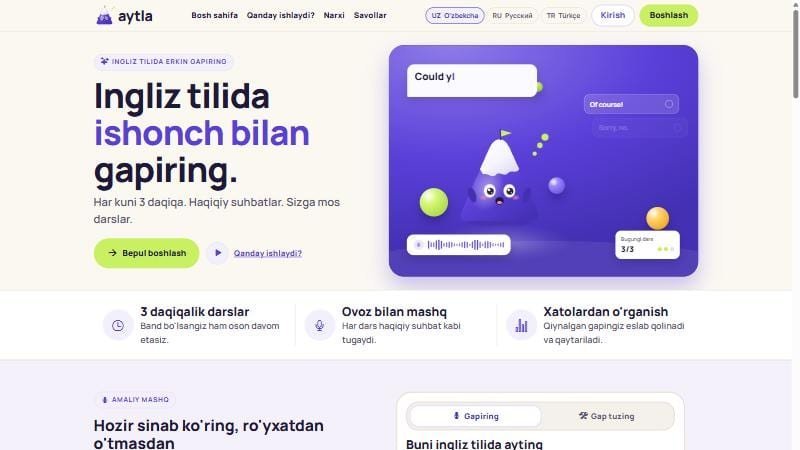
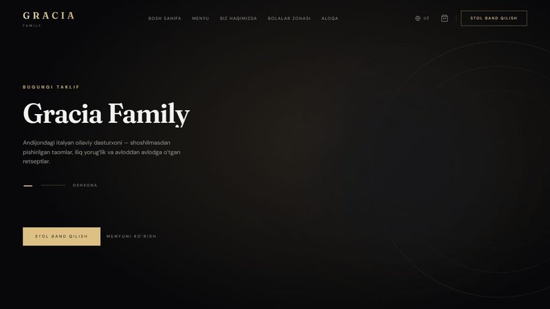
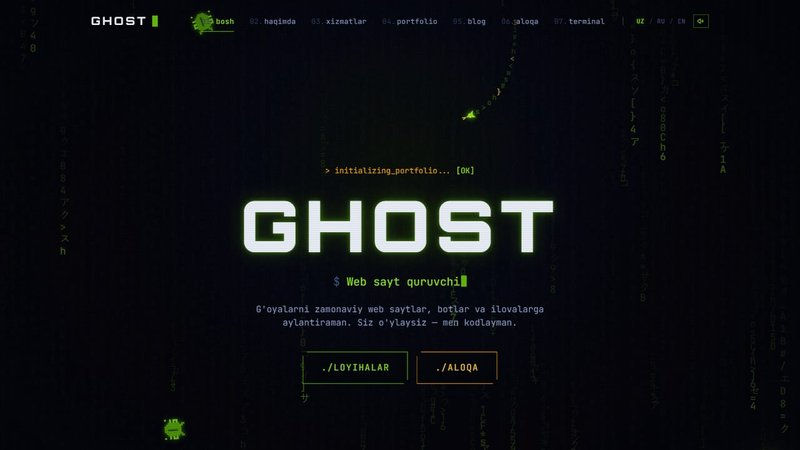
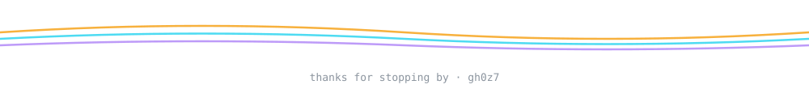

 

<h2 align="center">Tech stack</h2>

   
   
  

<h2 align="center">Featured projects</h2>

<table>
  <tr>
    <td width="50%" valign="top">
      
      <h3><a href="https://github.com/Gh0z77/uzgrow-3d-site">UZ GROW · 3D scroll site</a></h3>
      A greenhouse is built, planted and harvested in 3D as you scroll. The scene is made in Blender and played in the browser like a film. 
      <code>Blender</code> <code>React Three Fiber</code> <code>GSAP</code> <code>TypeScript</code>
    </td>
    <td width="50%" valign="top">
      
      <h3><a href="https://github.com/Gh0z77/3d-issiqxona">3D greenhouse + profit calculator</a></h3>
      Interactive 3D seedling greenhouse: pick a crop, tweak prices and see the yearly profit. <a href="https://3d-issiqxona-ten.vercel.app">Live ↗</a> 
      <code>Three.js</code> <code>React Three Fiber</code> <code>TypeScript</code>
    </td>
  </tr>
  <tr>
    <td width="50%" valign="top">
      
      <h3><a href="https://github.com/Gh0z77/yasa">Yasa · AI app builder</a></h3>
      Describe an app in chat; AI writes a real React + Vite project and shows it live next to the chat. <a href="https://yasa-beta.vercel.app">Live ↗</a> 
      <code>React</code> <code>Node.js</code> <code>Claude API</code> <code>Gemini</code>
    </td>
    <td width="50%" valign="top">
      
      <h3><a href="https://github.com/Gh0z77/aytla">Aytla · speaking-first language app</a></h3>
      Every lesson ends in speaking. One codebase runs on the web, Android and iOS, with AI conversation practice. 
      <code>Expo</code> <code>React Native</code> <code>Node.js</code>
    </td>
  </tr>
  <tr>
    <td width="50%" valign="top">
      
      <h3><a href="https://github.com/Gh0z77/gracia-digital-elegance">Gracia · restaurant website</a></h3>
      Interactive menu, pre-orders and table booking for an Italian family restaurant. <a href="https://gracia-digital-elegance.vercel.app">Live ↗</a> 
      <code>TanStack Start</code> <code>Supabase</code> <code>Tailwind</code>
    </td>
    <td width="50%" valign="top">
      
      <h3><a href="https://github.com/Gh0z77/Portifolio-web-site">GHOST · portfolio</a></h3>
      Cyberpunk-terminal portfolio with an admin panel, its own analytics and 3 languages. <a href="https://portifolio-web-site-three.vercel.app">Live ↗</a> 
      <code>React</code> <code>Supabase</code> <code>Framer Motion</code>
    </td>
  </tr>
</table>

  <b>Also:</b>
  <a href="https://github.com/Gh0z77/yesmine-boutique-suite">Yesmine e-commerce store</a> ·
  <a href="https://github.com/Gh0z77/yesmine-panel">Yesmine staff panel (RLS)</a> ·
  <a href="https://github.com/Gh0z77/ad-post-bot">Telegram ad-post bot</a>

<h2 align="center">Activity</h2>

  <picture>
    <source media="(prefers-color-scheme: dark)" srcset="https://raw.githubusercontent.com/Gh0z77/Gh0z77/output/github-snake-dark.svg" />
    
  </picture>

