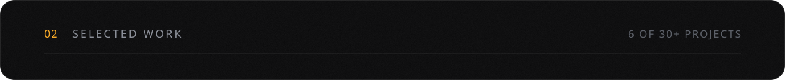

  
  

  
  

  
  

  More on GitHub:
  <a href="https://github.com/Gh0z77/yesmine-boutique-suite">Yesmine store</a> ·
  <a href="https://github.com/Gh0z77/yesmine-panel">Yesmine staff panel</a> ·
  <a href="https://github.com/Gh0z77/ad-post-bot">Telegram ad-post bot</a>

